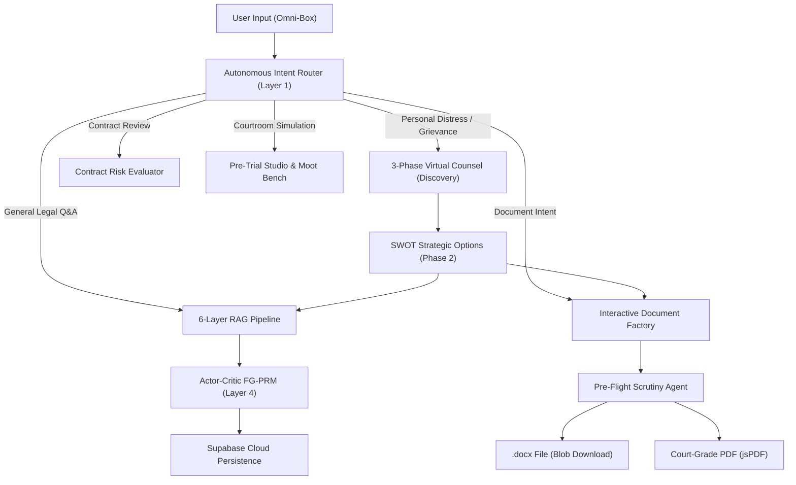

# ⚖️ SaulGPT — Functional Design Document (FDD)
**Document Version:** 2.3.0 (16 Nov 2026: verified against code and live production; see §5–§7)  
**Target Release:** Production Cloud (Hugging Face Spaces + Supabase + Firebase)  
**Frontends:** Classic UI (`saulgpt-ui`) and Clean UI (`saulgpt-ui-clean`), with identical behaviour on one shared backend  
**System Classification:** Neuro-Symbolic Indian Legal Intelligence Platform  
**Governing Jurisprudence:** Republic of India (Constitution of India, BNS 2023, BNSS 2023, BSA 2023, CPC 1908, NIA 1881, ICA 1872)

---

## 1. Executive Summary & Purpose

SaulGPT is an autonomous, AI-driven legal intelligence platform engineered specifically for the Indian legal ecosystem. It serves as an institutional-grade virtual counsel for citizens, practicing litigators, corporate legal teams, and law researchers.

### 1.1 Core Problems Addressed
1. **The 2024 Legal Overhaul Barrier:** On July 1, 2024, India repealed its colonial criminal codes (IPC 1860, CrPC 1973, Indian Evidence Act 1872) in favor of the Bharatiya Nyaya Sanhita (BNS 2023), Bharatiya Nagarik Suraksha Sanhita (BNSS 2023), and Bharatiya Sakshya Adhiniyam (BSA 2023). Most general LLMs hallucinate obsolete colonial provisions and conflate prospective vs. retrospective applicability under Article 20(1) of the Constitution.
2. **Access to Justice Gap:** Millions of litigants face high legal consultation fees, complex procedural jargon, and strict statutory limitation deadlines (e.g. 15-day cheque bounce notices under Section 138 NIA or 3-year limitation periods under the Limitation Act 1963).
3. **Pleading Deficiencies:** Over 40% of civil suits suffer dismissal at the intake stage under Order VII Rule 11 of the Code of Civil Procedure (CPC) due to omission of the "Triad of Survival" (Limitation, Territorial/Pecuniary Jurisdiction, and Court Valuation).
4. **Electronic Evidence Rejection:** Following the enactment of Section 63 BSA 2023 (replacing Section 65B IEA), digital evidence submitted without cryptographic hashing and statutory compliance certificates is routinely rejected in trial courts.

---

## 2. User Personas & Primary Journeys

| Persona | Needs & Goals | Primary Features Used |
| :--- | :--- | :--- |
| **Distressed Citizen** | Needs immediate legal clarity, protection from unlawful police action, or recovery of unpaid rent/salary. | Omni-Box, 3-Phase Discovery, Cheque Bounce Notice Drafter, Limitation Countdown. |
| **Litigating Advocate** | Requires adversarial moot rehearsal, case law precedents, and Order VII CPC plaint drafting. | Pre-Trial Studio, Section 146 BSA Cross-Examiner, Precedent Search Engine, Plaint Drafter. |
| **In-House Legal Counsel** | Audits master services agreements, non-competes, and commercial leases for statutory compliance. | Contract Evaluator (25K token single pass), Section 27 ICA Audit, Risk Calibration. |
| **Law Student / Researcher** | Studies statutory transitions, coram hierarchy, and landmark Supreme Court struck-down rulings. | Knowledge Graph Visualizer, BNS Concordance Grid, Supreme Court Firewall. |

---

## 3. Core Functional Modules

### 3.1 Module 1: Omni-Box & Autonomous Intent Routing
- **No Manual Mode Dropdown:** The user enters natural language directly into a unified prompt bar.
- **Autonomous Intent Detection:**
  - **Statutory Q&A:** Textbook queries (*"What is Section 35 of BNSS 2023?"*) route directly to the 6-Layer RAG Engine.
  - **First-Person Grievance:** Possessive indicators (*"my landlord locked me out"*, *"they cheated me"*) trigger the 3-Phase Virtual Counsel Discovery workflow.
  - **Drafting Request:** Action requests (*"draft a notice"*, *"cheque bounce notice"*) trigger the Interactive Drafter.
  - **Contract Evaluation:** Pasted contractual terms or clauses trigger the 25,000-character Evaluator.
  - **Adversarial Analysis:** Requests for arguments or courtroom strategies trigger the IRAC Advocate Mode.

---

### 3.2 Module 2: 3-Phase Virtual Counsel Workflow
- **Phase 1: Discovery (Empathetic Investigation):**
  - Strictly capped at a maximum of 3 turns by a deterministic state machine.
  - Objective-driven progression: Turn 1 (Factual Story) $\rightarrow$ Turn 2 (Evidence & Timeline) $\rightarrow$ Turn 3 (Desired Outcome).
  - Dynamic JSON extraction yields a `discovery_profile` (emotional state, key events, evidence strength, opponent profile).
- **Phase 2: Strategy Advisory (SWOT & Paths):**
  - Synthesizes a structured legal SWOT matrix (Strengths, Weaknesses, Opportunities, Threats), shown on demand ("Show strengths & risks").
  - Presents exactly 4 strategic action cards (`path_a` to `path_d`), each with a **label, a description and a `route_to`** (`document` → drafting interview, `pathfinder` → step-by-step procedure).
  - Optional banners above the cards: **limitation warning** (`limitation_warning`) and **jurisdiction note** (`jurisdiction_note`).
  - Two extra actions: **Explain these options** (sends `explain`) and **Advocate Mode** (sends `advocate` → IRAC deep analysis: Facts / Issues / Rule / Application arguing both sides / Conclusion).
  - ⚠️ *Not implemented:* per-option success probability, time horizon and procedural difficulty. The strategy prompt does not produce these fields and neither UI renders them (see §7, G-8).
- **Phase 3: Execution:**
  - Seamless 1-click execution: Selecting a card immediately triggers either document drafting or an action roadmap without re-asking established facts.
  - Drafting runs as an interview with a progress bar (`progress_pct`). It can be cancelled at any time ("Cancel draft"), and it ends in an explicit confirmation before the `.docx` is generated.

---

### 3.3 Module 3: Court-Grade Document Factory (4 Families)
Supports 4 structured document families with 10+1 architectural rendering primitives:

1. **Letter / Notice Family (`letter`):**
   - Statutory 15-Day Cheque Bounce Notice (Section 138 Negotiable Instruments Act, 1881).
   - Demand Notice for Unpaid Salary / Professional Fees.
   - Tenancy Eviction & Default Notice (Transfer of Property Act, 1882).
   - **Enforced Elements:** Formal `RPAD` dispatch header, `FROM:` sender block, `TO:` recipient block, current date, statutory demand clause with deadline, enclosures list, advocate signature block.
2. **Pleading Family (`pleading`):**
   - Civil Plaints & Injunction Suits (Order VII Rule 1 CPC).
   - Criminal Complaints to Judicial Magistrate (Section 223 BNSS 2023).
   - **Enforced Elements (The Triad of Survival):**
     1. *Cause of Action & Limitation Clause:* Exact date when cause arose and statutory period.
     2. *Territorial & Pecuniary Jurisdiction Clause:* Specific grounds why the court has jurisdiction.
     3. *Valuation & Court Fee Clause:* Exact suit valuation and stamp duty.
     4. *Attestation Clause:* Order VI Rule 15 CPC verification split.
3. **Affidavit Family (`affidavit`):**
   - Evidentiary affidavits in support of petitions, name changes, or lost documents.
   - **Enforced Elements:** First-person narrative, 5.5-inch stamp paper top margin, deponent age/parentage, notary attestation split (personal knowledge vs. legal advice).
4. **Agreement Family (`agreement`):**
   - Commercial Lease Agreements, Service Level Agreements, Non-Disclosure Agreements.
   - **Enforced Elements:** Recitals (`WHEREAS` clauses), operative covenants, property schedule table, Section 7 Arbitration & Conciliation Act 1996 dispute resolution clause, bilateral signature blocks, witness blocks.

#### Document Export & Prompt Sanitization:
- **Zero Prompt Leakage:** Strips internal tags (`[User Goal: document]`, `assist me...`) before drafting.
- **Deterministic Fallback Engine:** If the LLM spec generator is interrupted, the engine synthesizes an authentic Indian legal notice using canonical statutory clauses.
- **Dual Export:**
  - **Microsoft Word (.docx):** Direct in-browser blob stream with fallback navigation.
  - **Formatted PDF:** Client-side vector PDF generation via `jsPDF`.

---

### 3.4 Module 4: Pre-Trial Studio & Precedent Intelligence
- **Three session modes:** *Dual Moot Court (with Coach)*, *Solo Cross-Examiner* and *Solo Defense Chambers* (`moot_court`, `cross_examiner`, `defense_fortifier`).
- **Witness role:** the user takes the stand as *Accused / Drawer* or *Complainant / Payee*. Opposing counsel's line of questioning adapts to the role.
- **Act filter:** all 8 acts, NI Act (Sec 138/139), BNS/BNSS/BSA 2023, Consumer Protection Act 2019, Indian Contract Act, Limitation Act (Sec 18), Arbitration Act.
- **Adversarial Cross-Examiner:** Formulates hard-hitting cross-examination questions under Section 146 of the Bharatiya Sakshya Adhiniyam, 2023 (`POST /api/trial/start`, then `POST /api/trial/turn` per answer).
- **Live instrumentation:** *Trial Exposure Radar* (vulnerability score and per-turn delta), *Corner Coach* (critique, objection, evidentiary plug, optimised rejoinder) and the *controlling precedent* card (title, citation, court, year, ratio decidendi, turning point).
- **Rest Case / Conclude** (`POST /api/trial/conclude`): final record with status label, judicial outlook, admissions on record and suggested statutory motions. If the call fails, a client-side record is produced from the last score.
- **Entry points:** sidebar/header button, the "Trial Studio" action under any answer (pre-fills the scenario), or "Launch cross-exam" from the Evidence Locker (pre-fills the scenario and attaches the grounded evidence).
- **Precedent Engine:** Indexes over 50,000 landmark Supreme Court and High Court judgments to retrieve authoritative case citations matching the dispute.
- *Legacy:* the older **Virtual Bench** modal (`POST /api/bench/debate`) is still mounted in both UIs, but nothing opens it any more, because Trial Studio superseded it (see §7, G-10).

---

### 3.5 Module 5: Multimodal Evidence Verification (Section 63 BSA)
- **Forensic Evidence Ingestion:** Two tabs: *Audio & Video* (voice notes, CCTV; Whisper transcription) and *Documents & Images* (bills, invoices, cheques, chats). Max **25 MB** per file (`POST /api/evidence/upload`).
- **Cryptographic Hashing:** SHA-256 is computed **in the browser before upload** (`client_hash`) and again on the server, so the two can be compared.
- **Certificate Generation:** Produces a court-admissible Section 63 BSA compliance certificate detailing device hash, extraction date, and custody log.
- **Statutory clocks:** for cheque memos, the Section 138(b) 30-day notice window is computed from the bank return date, with a manual date entry fallback.
- **1-click samples:** "Sample Certified Cheque & Memo" and "Sample Uncertified WhatsApp Audio" demonstrate the flow without a real file.
- **Hand-offs:** *Apply to chat* writes a structured `[EVIDENCE GROUNDED: …]` brief into the message box. *Launch cross-exam* opens Trial Studio with the evidence attached.

---

### 3.6 Module 6: Contract Risk Evaluator (Layer 6)
- **Input:** PDF, DOCX or TXT up to **50 MB** (`POST /api/upload`), uploaded via the paperclip/"Contract" button, the "Review a contract" card, or (Clean UI) by dragging a file onto the chat.
- **High-Capacity Analysis:** Evaluates entire agreements up to 25,000 characters in a single pass to eliminate multi-chunk fragmentation.
- **Statutory Risk Scoring:**
  - 🔴 **High Risk:** Void/unlawful terms (Section 27 non-compete covenants, Section 28 legal proceeding restraints, Section 74 penalty liquidated damages).
  - 🟡 **Medium Risk:** Commercial exposure (vague indemnity, unilateral termination, missing IP assignment).
  - 🟢 **Low Risk:** Fair, enforceable, bilateral agreements.

---

### 3.7 Module 7: Indian Legal Glossary & Layman Decoder
- **Interactive Term Ribbon:** Detects over 200 Indian legal terms in responses (e.g. *Anticipatory Bail, Cognizable, Ex-Parte, Lok Adalat, Mens Rea, Quash, Res Judicata, Caveat*).
- **Everyday Analogies:** Translates complex legal terminology into intuitive real-life explanations directly in the chat view.
- **Glossary panel:** "Terms found in the latest answer" plus "Browse all terms" by category. The Classic UI shows it as a slide-in sidebar. The Clean UI shows it as the *Glossary* tab of the right-hand panel, with a search box.

---

### 3.8 Module 8: Multi-Device Persistence & Cloud Accounts
- **Accounts:** Email/password account creation with JWT authentication (30-day token expiry). **Both UIs require sign-in before the chat is shown.**
  - ⚠️ *Correction (v2.3):* earlier versions described "immediate anonymous guest access with cloud sync". In practice the UIs gate everything behind sign-in. The backend still maps any request **without a valid token** to a shared guest user (id 1), and the guest-takeover endpoint `POST /api/conversations/migrate` is never called by either UI (see §7, G-2 and G-9).
- **Conversation history:** list (paged, 25 at a time, "Load more"), open, delete and "New conversation"; titles are auto-set from the first message.
- **Multi-Device History:** Chat turns are persisted in Supabase PostgreSQL and synced across mobile and desktop browsers.
- **Session safety:** an expired token (401) signs the user out automatically. Signing out in one browser tab signs out every open tab (cross-tab `storage` sync).

---

### 3.9 Module 9: Bring-Your-Own-Key (BYOK) Security
- **Compulsory User Key Isolation:** Users enter their personal Groq API key (`gsk_...`) in a secure modal.
- **Zero Server-Side Key Storage:** Keys are saved strictly in the user's browser `localStorage` and transmitted per-request via the `X-Groq-Api-Key` HTTP header.
- **Test connection:** the key modal can verify a key before saving (`POST /api/keys/validate` → number of models available).
- **Rate-limit recovery:** any `429` or "rate limit" error automatically re-opens the key modal with an explanation.

---

### 3.10 Module 10: Response Intelligence Widgets
Every answer can carry structured metadata, which both UIs render around the text:

| Widget | Backend field(s) | What the user sees |
| :--- | :--- | :--- |
| BNS Correction Notice | `remapped_laws`, `scrutiny.warnings` | "Legislation Update 2024": repealed IPC/CrPC/IEA section → its BNS/BNSS/BSA replacement (compact after the first one in a chat) |
| Urgency Banner | `urgency_flags`, `urgency_reason`, `limitation_days`, `limitation_expiry` | Red deadline alert when a limitation period is close |
| Jurisdiction Badge | `jurisdiction_mapped` | Which court/forum the matter belongs to |
| Veto / Scrutiny Card | `scrutiny` (`severity`, `veto_message`, `warnings`, `can_proceed`), `critic_deliberation` | Pre-flight legal scrutiny; serious issues need an explicit "I understand" before proceeding |
| Toulmin Matrix | `toulmin_matrix` | Claim, grounds, warrant, rebuttal breakdown |
| **Oral Case Briefing** | `oral_briefing` | 🔊 3-sentence spoken summary (browser text-to-speech). *Wired into both UIs in v2.3. The backend was already producing it.* |
| **Procedural Roadmap Infographic** | `infographic_data` (`decision_tree` / `transition_matrix`) | Visual step-by-step or old-law → new-law roadmap. *Wired into both UIs in v2.3. The backend was already producing it.* |
| Decoded Terms Ribbon | (client-side scan of the text) | Clickable legal terms with plain-language meanings |
| Sources / Pipeline Meta | `mode_used`, `domain`, `laws_retrieved`, `citations[]`, `confidence_score`, `is_hallucinating`, `repealed_warnings`, `struck_down_warnings`, `elapsed_seconds` | Classic UI: collapsible bar under the answer. Clean UI: summary chips under the answer, with full details in the **Sources** tab |
| Exports | `document_ready`, `document_url` | Copy, PDF (jsPDF, client-side), editable `.docx` (blob download) |

---

## 4. Regulatory & Constitutional Guardrails

1. **Article 20(1) Non-Retroactivity Engine:** Offenses committed prior to July 1, 2024 remain strictly governed by IPC 1860 and CrPC 1973; offenses committed on or after July 1, 2024 are mapped to BNS 2023 and BNSS 2023.
2. **Supreme Court Struck-Down Firewall:** Prevents citation of invalidated laws as active offenses:
   - *Shreya Singhal (2015)*: Section 66A IT Act struck down.
   - *Joseph Shine (2018)*: Section 497 IPC (Adultery) struck down.
   - *Navtej Singh Johar (2018)*: Section 377 IPC decriminalized for consensual acts.
   - *K.S. Puttaswamy (2018)*: Section 57 Aadhaar Act struck down for private entities.
3. **Limitation Act 1963 Calculator:** Alerts users whenever statutory prescription periods are close to expiring.

---

## 5. Presentation Layer: Two Frontends, One Behaviour

SaulGPT ships two interchangeable web frontends over the same backend. A user can pick either and gets the same features, data and results.

| | Classic UI (`saulgpt-ui/`) | Clean UI (`saulgpt-ui-clean/`) |
| :--- | :--- | :--- |
| Look | Dark "courtroom": mahogany & gold, serif display type | Minimal 3-pane workspace, zinc + one blue accent, Inter type, **Light/Dark toggle** |
| Layout | Single centred column; tools as header buttons; history in a slide-in drawer | Top bar (status, theme, log out) · **left sidebar** (New Conversation, Tools, History, API key) · centred chat with one composer · **right panel** (Sources / Glossary / Guide) |
| Onboarding | Feature cards + suggested matters | 4 action cards + suggested matters + an always-available 4-step **Guide** tab |
| Contract upload | Paperclip, or "Evaluate Contracts" card → drop zone | Paperclip/"Contract" button, "Review a contract" card (opens picker directly), **drag a file onto the chat** |
| Mobile | Responsive column | Sidebar becomes a ☰ drawer; right panel becomes an overlay |
| Dev URL / build / deploy | `:5173` · `dist/` · `firebase.json` | `:5174` · `dist-clean/` · `firebase.clean.json` (separate Firebase site) |

**Parity guarantee.**
- **Shell logic:** the Clean UI's state and API logic (sessions, conversations, drafting interview, strategy choices, uploads, BYOK checks, 401/429 handling) is carried over line for line from the Classic `App.jsx`.
- **Feature components:** Trial Studio, Evidence Locker, Veto card, Toulmin, BNS notice, Urgency, Jurisdiction, Infographic, Audio briefing, Glossary data and the PDF engine are **copied from the Classic UI** by `saulgpt-ui-clean/scripts/sync_features.py`. The script re-colours their CSS to the new theme and leaves their logic unchanged.
- **Rule for contributors:** change feature components in `saulgpt-ui/src` and re-run the script. Mirror any API/state change in classic `App.jsx` into the clean `App.jsx`.

**Security of rendered text (both UIs, v2.3).** Answer text is HTML-escaped before the light Markdown formatting is applied, and only `http(s)://` or `/api/…` links become clickable. This blocks script injection through LLM output, for example a contract containing `` that the model quotes back.

---

## 6. Verification Record (v2.3, 16 Nov 2026)

Automated browser tests (Playwright, Chromium) drove **both** UIs through identical scripts. Every API request was recorded, normalised (session IDs) and diffed between the two UIs.

### 6.1 Feature parity, Classic vs Clean (mock backend)
| Area | Checks | Result | Requests identical? |
| :--- | :--- | :--- | :--- |
| Sign-in, conversation list/open/delete/new, 401 auto-logout, 429 → key modal | 8 | ✅ 8/8 in both UIs | ✅ |
| Grievance → strategy options → pick option → drafting interview (progress bar) → `.docx` download | (included above) | ✅ | ✅ |
| Contract upload (`/api/upload`) | (included above) | ✅ | ✅ |
| Explain options, Advocate Mode (IRAC) | 2 | ✅ | ✅ |
| PDF export (valid `%PDF` file produced) | 1 | ✅ | ✅ |
| BYOK "Test connection" (`/api/keys/validate`) | 1 | ✅ | ✅ |
| Evidence upload (`/api/evidence/upload`, multipart incl. client SHA-256) → result → *Apply to chat* | 2 | ✅ | ✅ |
| Sample cheque → *Launch cross-exam* → Trial Studio pre-filled | 1 | ✅ | ✅ |
| Trial Studio start → witness answer → conclude → back to chat | 5 | ✅ | ✅ |
| **Total** | **20 per UI** | **40/40** | **✅ byte-identical** |

The only request difference is that the Clean UI refreshes the conversation list more often, because its sidebar is always visible. This has no functional impact.

### 6.2 Clean-UI-specific behaviour
13/13 checks pass:
- the contract card and sidebar entry open the file picker
- drag-and-drop uploads a file
- answer chips (mode, area, laws, validated) appear
- the Sources tab shows citations with the repealed flag, confidence and repealed warnings
- the Glossary tab shows terms found in the answer, with working search and a no-match state
- HTML in replies is shown as text, while Markdown bold and `/api` links still work

### 6.3 Live production backend (`lvvbaaal-legalgpt-api.hf.space`)
- `/api/health` is online (v2.0.0).
- A knowledge query ("punishment for cheating under BNS 2023") returns a correct BNS answer with 7 laws retrieved, `oral_briefing` and `infographic_data`. **Latency is 2–4 min per answer** (ZeroGPU cold start plus the pipeline).
- The exact production payload was replayed through both UIs: BNS notice, roadmap infographic, oral briefing, mode/laws labels and PDF all render (after fixes F-1 and F-4 below).

### 6.4 Defects found and fixed in v2.3
| # | Severity | Defect | Fix | Verified |
| :--- | :--- | :--- | :--- | :--- |
| F-1 | **Critical** | Both UIs used `meta.meta \|\| meta`. The backend adds a nested `meta` (`remapped_laws`) whenever an answer mentions IPC/CrPC/IEA, so **all other widgets vanished** on those answers in production (citations, confidence, scrutiny, urgency, jurisdiction, Toulmin, PDF rules, infographic, briefing). | Merge both levels (`{...meta, ...meta.meta}`) in both UIs | Real production payload replayed ✅ |
| F-2 | **Critical** | **Sign-up fails in production** ("Failed to create user account"; 9/9 attempts failed). Explicit-id inserts (guest id 1, token ids, likely the SQLite→Supabase migration) leave the Postgres `users.id` sequence behind, so new inserts hit duplicate keys. | `_pg_sync_users_id_seq()` re-aligns the sequence after explicit-id inserts and before `create_user`. This also heals affected databases. | Reproduced and fixed on local Postgres 16, including an already-broken database; SQLite path unchanged ✅. **Needs backend redeploy.** |
| F-3 | **High (security)** | Classic UI rendered answer HTML unescaped: `` in a reply executed script (XSS via LLM echo of uploaded documents). | Escape HTML before Markdown; only linkify `http(s)`/`/api` URLs; escape `"` (both UIs) | Payload no longer executes in either UI ✅ |
| F-4 | Medium | `oral_briefing` and `infographic_data` were produced by the backend but never displayed by either UI. | Render `AudioPillPlayer` and `LegalInfographic` in both UIs | ✅ |
| F-5 | Medium | Cross-tab logout was documented but missing in the Classic UI. | `storage` listener added | ✅ |
| F-6 | Low | Clean-UI re-theming: dark text on accent buttons, gradient titles, Trial Studio opening scrolled to the bottom. | Sync script made block-aware; scroll only once a session starts | Screenshots, light and dark ✅ |

---

## 7. Known Gaps & Road to "Masterclass" (prioritised)

| ID | Priority | Gap | Recommendation |
| :--- | :--- | :--- | :--- |
| G-1 | **P0** | Fix F-2 is in code but not live. Until the backend is redeployed, **new users cannot register**. | Redeploy the Hugging Face Space (`deploy_hf.py`), then sign up once to confirm. |
| G-2 | **P0 (privacy)** | Any request without a valid token is mapped to the shared guest user (id 1). Anonymous callers write to, and can list, one shared "guest" history, and a bad or expired token silently falls into it. | Return 401 for conversation endpoints without a valid token. Keep guest handling only for stateless Q&A, or give each guest a random per-browser id. |
| G-3 | P1 (security) | `/api/trial/*`, `/api/evidence/upload`, `/api/bench/debate` and `/api/keys/validate` accept unauthenticated requests. The UIs send no token to them. | Require the Bearer token (both UIs already hold it), and rate-limit per user. |
| G-4 | P1 (UX) | 2–4 minutes per answer, with only a typing indicator. | Keep the Space warm; stream tokens (SSE) or show pipeline stage progress (Understanding → Retrieval → Reasoning → Validation). |
| G-5 | P1 | Live answers can report `laws_retrieved: 7` with `citations: []`, so the Sources panel has nothing to cite. | Populate `citations` from Layer 2 hits (act and section) on every answer. |
| G-6 | P1 | Trial Studio reports failures with a browser `alert()`. | Show an inline error with a Retry button. |
| G-7 | P2 | The JS bundle is ~800 KB (jsPDF, html2canvas). | Lazy-load PDF export and Trial Studio (`import()`). |
| G-8 | P2 | Strategy cards lack success probability, time horizon and difficulty (described in earlier FDD versions). | Add the fields to `prompts/strategy.py` and validation, then render them as chips on each card. |
| G-9 | P2 | `POST /api/conversations/migrate` (guest takeover) is never called; sign-in is required up front. | Either remove it, or support a real guest mode (see G-2) and call it after sign-in. |
| G-10 | P2 | The legacy **Virtual Bench** modal is mounted but unreachable (superseded by Trial Studio). | Remove it, or expose it as a "Quick debate" mode inside Trial Studio. |
| G-11 | P2 | Accessibility: icon-only buttons rely on `title`; the classic UI's colour contrast is low in places. | Add `aria-label`s and run an axe audit in CI. |
| G-12 | P2 | No automated UI tests in the repository. | Commit the Playwright parity suite (§6) and run it in CI for both UIs. |
