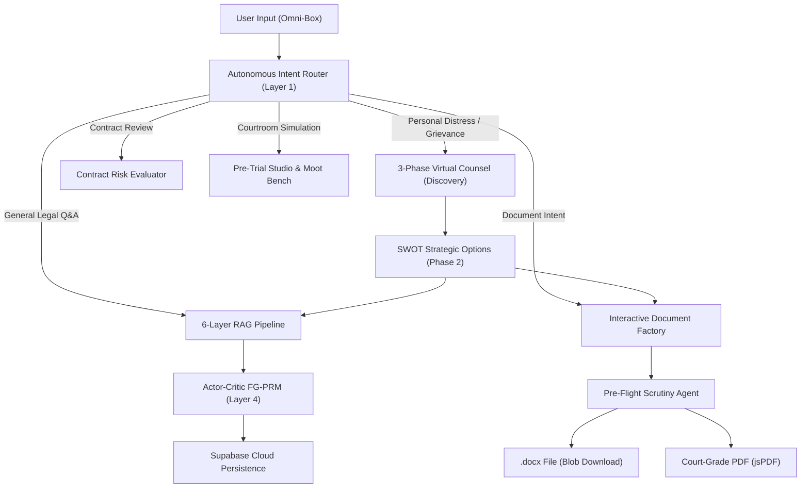

# ⚖️ SaulGPT — Functional Design Document (FDD)
**Document Version:** 2.2.0  
**Target Release:** Production Cloud (Hugging Face Spaces + Supabase + Firebase)  
**System Classification:** Neuro-Symbolic Indian Legal Intelligence Platform  
**Governing Jurisprudence:** Republic of India (Constitution of India, BNS 2023, BNSS 2023, BSA 2023, CPC 1908, NIA 1881, ICA 1872)

---

## 1. Executive Summary & Purpose

SaulGPT is an autonomous, AI-driven legal intelligence platform engineered specifically for the Indian legal ecosystem. It serves as an institutional-grade virtual counsel for citizens, practicing litigators, corporate legal teams, and law researchers.

### 1.1 Core Problems Addressed
1. **The 2024 Legal Overhaul Barrier:** On July 1, 2024, India repealed its colonial criminal codes (IPC 1860, CrPC 1973, Indian Evidence Act 1872) in favor of the Bharatiya Nyaya Sanhita (BNS 2023), Bharatiya Nagarik Suraksha Sanhita (BNSS 2023), and Bharatiya Sakshya Adhiniyam (BSA 2023). Most general LLMs hallucinate obsolete colonial provisions and conflate prospective vs. retrospective applicability under Article 20(1) of the Constitution.
2. **Access to Justice Gap:** Millions of litigants face high legal consultation fees, complex procedural jargon, and strict statutory limitation deadlines (e.g. 15-day cheque bounce notices under Section 138 NIA or 3-year limitation periods under the Limitation Act 1963).
3. **Pleading Deficiencies:** Over 40% of civil suits suffer dismissal at the intake stage under Order VII Rule 11 of the Code of Civil Procedure (CPC) due to omission of the "Triad of Survival" (Limitation, Territorial/Pecuniary Jurisdiction, and Court Valuation).
4. **Electronic Evidence Rejection:** Following the enactment of Section 63 BSA 2023 (replacing Section 65B IEA), digital evidence submitted without cryptographic hashing and statutory compliance certificates is routinely rejected in trial courts.

---

## 2. User Personas & Primary Journeys

| Persona | Needs & Goals | Primary Features Used |
| :--- | :--- | :--- |
| **Distressed Citizen** | Needs immediate legal clarity, protection from unlawful police action, or recovery of unpaid rent/salary. | Omni-Box, 3-Phase Discovery, Cheque Bounce Notice Drafter, Limitation Countdown. |
| **Litigating Advocate** | Requires adversarial moot rehearsal, case law precedents, and Order VII CPC plaint drafting. | Pre-Trial Studio, Section 146 BSA Cross-Examiner, Precedent Search Engine, Plaint Drafter. |
| **In-House Legal Counsel** | Audits master services agreements, non-competes, and commercial leases for statutory compliance. | Contract Evaluator (25K token single pass), Section 27 ICA Audit, Risk Calibration. |
| **Law Student / Researcher** | Studies statutory transitions, coram hierarchy, and landmark Supreme Court struck-down rulings. | Knowledge Graph Visualizer, BNS Concordance Grid, Supreme Court Firewall. |

---

## 3. Core Functional Modules

### 3.1 Module 1: Omni-Box & Autonomous Intent Routing
- **No Manual Mode Dropdown:** The user enters natural language directly into a unified prompt bar.
- **Autonomous Intent Detection:**
  - **Statutory Q&A:** Textbook queries (*"What is Section 35 of BNSS 2023?"*) route directly to the 6-Layer RAG Engine.
  - **First-Person Grievance:** Possessive indicators (*"my landlord locked me out"*, *"they cheated me"*) trigger the 3-Phase Virtual Counsel Discovery workflow.
  - **Drafting Request:** Action requests (*"draft a notice"*, *"cheque bounce notice"*) trigger the Interactive Drafter.
  - **Contract Evaluation:** Pasted contractual terms or clauses trigger the 25,000-character Evaluator.
  - **Adversarial Analysis:** Requests for arguments or courtroom strategies trigger the IRAC Advocate Mode.

---

### 3.2 Module 2: 3-Phase Virtual Counsel Workflow
- **Phase 1: Discovery (Empathetic Investigation):**
  - Strictly capped at a maximum of 3 turns by a deterministic state machine.
  - Objective-driven progression: Turn 1 (Factual Story) $\rightarrow$ Turn 2 (Evidence & Timeline) $\rightarrow$ Turn 3 (Desired Outcome).
  - Dynamic JSON extraction yields a `discovery_profile` (emotional state, key events, evidence strength, opponent profile).
- **Phase 2: Strategy Advisory (SWOT & Paths):**
  - Synthesizes a structured legal SWOT matrix (Strengths, Weaknesses, Opportunities, Threats).
  - Presents exactly 4 strategic action cards (`path_a` to `path_d`) with estimated success probability, time horizon, and procedural difficulty.
- **Phase 3: Execution:**
  - Seamless 1-click execution: Selecting a card immediately triggers either document drafting or an action roadmap without re-asking established facts.

---

### 3.3 Module 3: Court-Grade Document Factory (4 Families)
Supports 4 structured document families with 10+1 architectural rendering primitives:

1. **Letter / Notice Family (`letter`):**
   - Statutory 15-Day Cheque Bounce Notice (Section 138 Negotiable Instruments Act, 1881).
   - Demand Notice for Unpaid Salary / Professional Fees.
   - Tenancy Eviction & Default Notice (Transfer of Property Act, 1882).
   - **Enforced Elements:** Formal `RPAD` dispatch header, `FROM:` sender block, `TO:` recipient block, current date, statutory demand clause with deadline, enclosures list, advocate signature block.
2. **Pleading Family (`pleading`):**
   - Civil Plaints & Injunction Suits (Order VII Rule 1 CPC).
   - Criminal Complaints to Judicial Magistrate (Section 223 BNSS 2023).
   - **Enforced Elements (The Triad of Survival):**
     1. *Cause of Action & Limitation Clause:* Exact date when cause arose and statutory period.
     2. *Territorial & Pecuniary Jurisdiction Clause:* Specific grounds why the court has jurisdiction.
     3. *Valuation & Court Fee Clause:* Exact suit valuation and stamp duty.
     4. *Attestation Clause:* Order VI Rule 15 CPC verification split.
3. **Affidavit Family (`affidavit`):**
   - Evidentiary affidavits in support of petitions, name changes, or lost documents.
   - **Enforced Elements:** First-person narrative, 5.5-inch stamp paper top margin, deponent age/parentage, notary attestation split (personal knowledge vs. legal advice).
4. **Agreement Family (`agreement`):**
   - Commercial Lease Agreements, Service Level Agreements, Non-Disclosure Agreements.
   - **Enforced Elements:** Recitals (`WHEREAS` clauses), operative covenants, property schedule table, Section 7 Arbitration & Conciliation Act 1996 dispute resolution clause, bilateral signature blocks, witness blocks.

#### Document Export & Prompt Sanitization:
- **Zero Prompt Leakage:** Strips internal tags (`[User Goal: document]`, `assist me...`) before drafting.
- **Deterministic Fallback Engine:** If the LLM spec generator is interrupted, the engine synthesizes an authentic Indian legal notice using canonical statutory clauses.
- **Dual Export:**
  - **Microsoft Word (.docx):** Direct in-browser blob stream with fallback navigation.
  - **Formatted PDF:** Client-side vector PDF generation via `jsPDF`.

---

### 3.4 Module 4: Pre-Trial Studio & Precedent Intelligence
- **Moot Court Simulation:** 2-column judicial chamber pitting Petitioner arguments against Respondent counter-defenses.
- **Adversarial Cross-Examiner:** Formulates hard-hitting cross-examination questions under Section 146 of the Bharatiya Sakshya Adhiniyam, 2023.
- **Precedent Engine:** Indexes over 50,000 landmark Supreme Court and High Court judgments to retrieve authoritative case citations matching the dispute.

---

### 3.5 Module 5: Multimodal Evidence Verification (Section 63 BSA)
- **Forensic Evidence Ingestion:** Accepts digital audio, invoice PDFs, and scanned cheque images.
- **Cryptographic Hashing:** Computes SHA-256 integrity hashes on upload.
- **Certificate Generation:** Produces a court-admissible Section 63 BSA compliance certificate detailing device hash, extraction date, and custody log.

---

### 3.6 Module 6: Contract Risk Evaluator (Layer 6)
- **High-Capacity Analysis:** Evaluates entire agreements up to 25,000 characters in a single pass to eliminate multi-chunk fragmentation.
- **Statutory Risk Scoring:**
  - 🔴 **High Risk:** Void/unlawful terms (Section 27 non-compete covenants, Section 28 legal proceeding restraints, Section 74 penalty liquidated damages).
  - 🟡 **Medium Risk:** Commercial exposure (vague indemnity, unilateral termination, missing IP assignment).
  - 🟢 **Low Risk:** Fair, enforceable, bilateral agreements.

---

### 3.7 Module 7: Indian Legal Glossary & Layman Decoder
- **Interactive Term Ribbon:** Detects over 200 Indian legal terms in responses (e.g. *Anticipatory Bail, Cognizable, Ex-Parte, Lok Adalat, Mens Rea, Quash, Res Judicata, Caveat*).
- **Everyday Analogies:** Translates complex legal terminology into intuitive real-life explanations directly in the chat view.

---

### 3.8 Module 8: Multi-Device Persistence & Cloud Accounts
- **Dual-Mode Persistence:**
  - **Guest Litigants:** Immediate anonymous access; sessions persist in browser `localStorage` and sync to cloud.
  - **Registered Litigants:** Email/password account creation with JWT authentication (30-day token expiry).
- **Multi-Device History:** Chat turns, evidence uploads, and drafted documents are persisted in Supabase PostgreSQL and synced across mobile and desktop browsers.

---

### 3.9 Module 9: Bring-Your-Own-Key (BYOK) Security
- **Compulsory User Key Isolation:** Users enter their personal Groq API key (`gsk_...`) in a secure modal.
- **Zero Server-Side Key Storage:** Keys are saved strictly in the user's browser `localStorage` and transmitted per-request via the `X-Groq-Api-Key` HTTP header.

---

## 4. Regulatory & Constitutional Guardrails

1. **Article 20(1) Non-Retroactivity Engine:** Offenses committed prior to July 1, 2024 remain strictly governed by IPC 1860 and CrPC 1973; offenses committed on or after July 1, 2024 are mapped to BNS 2023 and BNSS 2023.
2. **Supreme Court Struck-Down Firewall:** Prevents citation of invalidated laws as active offenses:
   - *Shreya Singhal (2015)*: Section 66A IT Act struck down.
   - *Joseph Shine (2018)*: Section 497 IPC (Adultery) struck down.
   - *Navtej Singh Johar (2018)*: Section 377 IPC decriminalized for consensual acts.
   - *K.S. Puttaswamy (2018)*: Section 57 Aadhaar Act struck down for private entities.
3. **Limitation Act 1963 Calculator:** Alerts users whenever statutory prescription periods are close to expiring.
